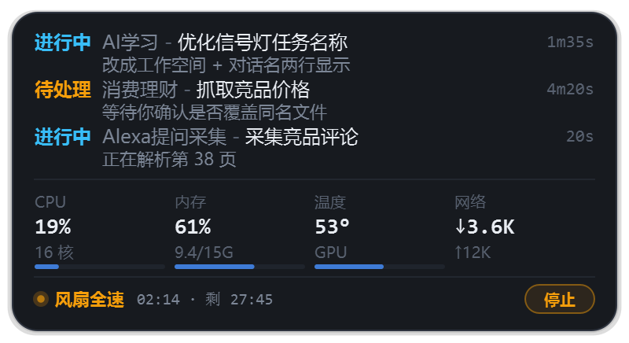

# AI 工作信号灯

Windows 桌面常驻小挂件。无边框、始终置顶、可拖拽，用一盏灯告诉你电脑上的 AI 任务现在处于什么状态，同时显示 CPU / 内存 / 设备温度 / 网速，并内置**笔记本散热控制**。



```
┌──────────────────────────────────────────────────┐
│  ●   进行中        AI学习 - 优化信号灯任务名称     │  ← 工作空间 - 对话名
│      改成工作空间 + 对话名两行显示            1m35s │  ← 这一轮在干什么
│  ──────────────────────────────────────────────  │
│  CPU       内存       温度        网络            │
│  33%       62%        50°         ↓3.8M          │
│  16 核     9.4/16G    GPU         ↑165K          │
│  ▬▬▬       ▬▬▬▬▬▬     ▬▬▬▬        ——             │
│  ● 风扇全速   02:14 · 剩 27:45          [ 停止 ] │  ← 有散热会话时才出现
└──────────────────────────────────────────────────┘
```

多个工作空间、多个对话同时跑时，卡片自动长高，一个任务一行：

```
┌──────────────────────────────────────────────────┐
│  进行中  AI学习 - 优化信号灯任务名称         1m35s │
│          改成工作空间 + 对话名两行显示             │
│  待处理  消费理财 - 抓取竞品价格             4m20s │
│          等待你确认是否覆盖同名文件                │
│  进行中  工作-202602-Alexa提问采集 - 采集竞品评论  │
│          正在解析第 38 页                     20s │
│  ──────────────────────────────────────────────  │
│  CPU       内存       温度        网络            │
└──────────────────────────────────────────────────┘
```

## 任务名称：工作空间 - 对话名

卡片第一行不再是"你刚才说的那句话"，而是**你在哪儿、在和哪个对话说话**；第二行才是这一轮的指令。

| 位置 | 内容 | 来源 |
|---|---|---|
| 第一行左 | `进行中` / `待处理` … | 当前聚合状态 |
| 第一行右 | `工作空间 - 对话名` | 工作空间名 + 会话标题 |
| 第二行 | 这一轮的指令摘要 | `prompt` 剥掉引用块/@徽标后取前 40 字 |

工作空间名取自 hook 传入的 `cwd`，优先查 `~/.workbuddy/workspace-display-names.json` 的 `displayName`（用户在 WorkBuddy 里改过名的以改名为准），查不到就退回目录名。

对话名取自 transcript 里的 `ai-title` 事件。这里有个坑值得记：**它固定在文件前 13KB 左右**（第 5 行），因为它在本轮第一次回复前就写好了；而一轮内的工具调用能追加几百 KB，从文件尾部反而读不到。所以读取顺序是"先扫头 64KB，再扫尾 24K/96K/384K 兜底"，实测 2.1ms。

首轮有个空窗：提交时标题还没生成，此时第一行只显示工作空间名，第二行显示指令——而不是把同一句话在上下两行重复一遍。标题生成后由下一次 `PostToolUse` 心跳补上，**一旦拿到就不再读盘**（否则每次工具调用多读 64KB）。

## 多任务并行

不同工作空间、不同对话同时跑时，卡片**自动长高**，一个任务占一行：

| 版式 | 每任务占高 | 显示内容 |
|---|---|---|
| 标准卡 400×138 | 30px | 标识行（状态词 + 工作空间 - 对话名 + 耗时）+ 指令行 |
| 横条 320×64 | 22px | 标识行；不显示指令（320px 放不下） |
| 竖版 200×248 | 30px | 色点 + 名称 + 指令；状态词只保留顶部聚合的一个 |

- **上限 3 行**。第 4 个起折成一行"另有 N 个任务在跑（右键 → 任务清单）"，卡片高度不再增长——常驻挂件不是任务管理器，无限长高会挡住桌面。
- **排序**沿用聚合优先级：`failed > waiting > running > done`，同级取更新的。
- **多任务时不画大灯**。大灯表达的是"唯一状态"，三个任务同时 running / waiting 时它没有意义；换成一行的状态标签 + 各自的耗时和色点，信息更准。
- 右键菜单新增 **任务清单（N）**，把这 N 个任务的名称全列出来，卡片上被截断的对话名在这里能看全。
- 窗口高度变化以**中心为锚点**，任务增减时卡片不会往右下角"长出去"。

## 五种状态

| 状态 | 灯色 | 表现 | 含义 |
|---|---|---|---|
| `idle` 无任务 | 灰 | 极缓呼吸 | 没有正在跑的任务 |
| `running` 进行中 | 青蓝 | 脉冲 + 旋转弧 | 任务执行中 |
| `done` 新完成 | 绿 | 高亮 + 扩散环 | 刚结束，停留 8 秒后回落 |
| `waiting` 待处理 | 琥珀 | 快速闪烁 | 在等你确认/输入 |
| `failed` 失败 | 红 | 常亮 + 强发光 | 出错，停留 60 秒 |

## 快速开始

**方式一：直接跑 exe（不需要 Python）**

到 [Releases](../../releases) 下载 `SignalLight.exe` 与 `fan_agent.exe`，放在同一目录，双击前者。单文件已内嵌运行时。

> 仓库不存 exe（单个 46MB，会把 clone 拖慢）。要自己出包：`打包.cmd`，产物在 `dist\`。

**方式二：从源码跑**

```bat
安装.cmd      :: 首次执行，建虚拟环境 + 装依赖 + 自检
启动.cmd      :: 启动挂件（有 exe 优先用 exe，否则用源码）
演示.cmd      :: 循环演示五种状态
```

启动后出现在屏幕右下角。**拖拽**移动，**双击**在标准卡/横条之间切换，**右键**出菜单（置顶 / 样式 / 尺寸 / 温度 / **散热** / 开机自启 / 演示 / 退出）。托盘图标双击可隐藏/显示。

> 所有 `.cmd` 内容为纯 ASCII。这是刻意的：cmd.exe 按系统 ANSI 代码页（中文 Windows 是 GBK）解析批处理，UTF-8 中文会直接把脚本解析崩掉。

---

# 散热模块

这部分是把原来独立的 `FanSpin.ps1` 并进来的结果。并进来之后 `dist\` 里只留一套 exe，右键菜单里多一个「散热」，卡片底部多一条散热条。

## 三个模式

三种方式都能让风扇转起来，但原理和代价完全不同。**优先级从上到下**：

| 模式 | 做什么 | 代价 | 前提 |
|---|---|---|---|
| **风扇全速** `ec` | 直接给联想 EC 发除尘指令，接管风扇 | 只有风噪 | 机型暴露 `\\.\EnergyDrv` |
| **持续负载** `burn` | N 个线程烧 CPU，靠真实发热带动风扇 | 满载发热、耗电、变烫 | 无 |
| **电源锁定** `spin` | 把最小处理器状态顶到 100%，空闲也不降频 | 持续发热、耗电，**会影响续航** | 管理员权限 |

**为什么首选 EC 直控**：它直接让风扇满速，CPU 不必发热。另外两个都是"用功耗换风量"——让机器更热，好让 EC 自己把风扇拉起来。同样是把风扇转起来，一个不加热，一个靠加热。

**为什么还留着后两个**：`\\.\EnergyDrv` 是联想私有接口，不是所有机型/驱动版本都有。没有它的时候，持续负载是唯一"一定有效"的手段（它不依赖任何接口），电源锁定则是不烧 CPU 的第二选择。

## 为什么分成"面板"和"执行体"两个进程

这是整个模块最重要的一条设计。

挂件是一个常驻、置顶、可拖拽的桌面小工具。**让一个装饰性窗口常驻管理员权限，等于给桌面开了全机写权限**。所以：

```
SignalLight.exe（普通权限，常驻）        fan_agent.exe（按需启动，活几分钟）
   │  写 stop.flag                            │
   ├───────────────────────────────────────► │  还原风扇 / 还原电源
   │  每 3 秒写 ui.beat                       │
   ├───────────────────────────────────────► │  90 秒读不到心跳就自己收手
   │                                          │
   │  每 0.5 秒读 session.json                │  每 1 秒写心跳
   │ ◄─────────────────────────────────────── ┤
```

三条约束，每条都对应一种真实的失败：

1. **提权进程杀不掉。** 界面是普通权限，`OpenProcess(TERMINATE)` 对高完整性进程直接失败。所以停止只能协商——写 `stop.flag`，agent 每 0.4 秒看一次。实测从点下停止到会话结束 0.2 秒。
2. **界面会先死。** 用户关掉挂件、挂件崩溃、注销，agent 都必须自己收手，否则风扇会一直全速转。所以界面每 3 秒写一次 `ui.beat`，agent 超过 90 秒读不到就还原退出。
3. **崩溃后必须能对账。** 电源策略是这个功能里唯一会跨进程存活的副作用。改之前先落一份**带截止时间**的备份到磁盘；下次启动发现"有备份但没有活会话"，就说明上次是被强杀/断电，自动拉起一次提权还原。这不是"可能有问题"，是 CPU 会被永久钉在 100% 最小状态。

用文件而不是管道/共享内存，是因为**文件是唯一在任一方崩溃后仍然可读的通道**。崩溃恢复恰恰是这个功能最需要的性质。

## 安全边界

| 机制 | 值 | 作用 |
|---|---|---|
| 默认时长 | 30 分钟（可设 10/20/30/60/120） | 到点 agent 自己还原并退出 |
| 硬上限 | 180 分钟 | `settings.json` 被手改成 9999 也会被夹回 |
| 界面心跳 | 90 秒 | 界面没了就停 |
| 会话心跳 | 8 秒 | 界面据此判断"灯还该不该亮" |
| 单实例 | 命名互斥量 + 会话文件 | 两个 agent 抢 EC 会让风扇在两个模式间抖 |
| 电源备份 | 落盘 + 截止时间 | 崩溃/断电后可还原 |
| 失败即放弃 | 备份写不进去就不改电源 | 不留后路就不动手 |
| EC 三次失败 | 自动中止 | 设备被抢走时不会空转 |

还有一个天然兜底：EC 的除尘周期约 9 秒，agent 每 8.9 秒才重置一次计时。**agent 如果是被强杀的，风扇最多再转 9 秒就自己回自动调速。** 这也是为什么 EC 模式比 `spin` 安全得多——`spin` 没有任何自愈能力，必须靠落盘备份。

## 散热面板

右键 → 散热 → 散热面板…（或菜单里直接点三种模式）

```
┌ 散热控制 ────────────────────────────────────────┐
│ EC 接口可读写 · 普通用户                          │
├──────────────────────────────────────────────────┤
│ CPU 占用     性能比        设备温度               │
│ 18%          219%          52°                    │
│ [温度趋势曲线 66px]                               │
│ 温度来源：GPU（adl）                              │
├──────────────────────────────────────────────────┤
│ 风扇全速 · 已运行 02:14 · 剩余 27:46              │
│ EC 接口可读写 · 已重置 15 次                      │
│ [停止并恢复] [还原电源设置]                       │
├──────────────────────────────────────────────────┤
│ 电源方案   处理器状态 最小/最大   系统散热方式     │
│ 平衡       5% / 100%            本机未暴露        │
├──────────────────────────────────────────────────┤
│ [风扇全速] [持续负载] [电源锁定]                  │
│ 时长 [30 分钟]  负载线程 [8]                      │
└──────────────────────────────────────────────────┘
```

**性能比**是这里新增的关键指标，也是原脚本最缺的那一环：`100%` = 基频，`>100%` 表示正在睿频。本机空载就在 180~220% 之间（4800U 睿频很激进）。

它解决的是原脚本的**开环问题**：脚本能下发命令，但本机 EC 不回读状态（`IOCTL_GET` 恒返回 133，改前改后一个值），作者的原话是"只能靠听"。现在至少有两个客观反馈——性能比有没有被抬起来、温度曲线往哪走。

面板里的所有数字每秒刷新；电源策略 8 秒读一次（`powercfg` 每次要起一个子进程，读太勤会掉帧）。

## 本机实测

| 项目 | 结果 |
|---|---|
| EC 接口 | `\\.\EnergyDrv` 可读写，**不需要管理员** |
| EC 状态回读 | 恒为 133（改前改后不变），不能当状态用 |
| 系统散热方式 `SYSCOOLPOL` | 本机 BIOS 未暴露，读不到 |
| 电源方案 | 平衡，最小 5% / 最大 100% |
| PDH `% Processor Performance` | 空载 180~220%，采样 ~1ms |
| 持续负载 8 线程 vs 1 线程 | 1.05 秒内吞吐 7.09 倍（8 核 16 线程） |
| 停止延迟 | 0.2 秒 |
| 启动延迟 | < 1 秒（源码模式） |

## 从脚本迁移的差异

| 原 `FanSpin.ps1` | 现在 |
|---|---|
| PowerShell + `Add-Type` 运行时编译 C# | Python `ctypes` 直接 `DeviceIoControl`，不编译 |
| 每个动作弹一次 UAC | 只有 `spin` 需要提权，`ec`/`burn` 不用 |
| 靠控制台输出判断 | 文件协议 + 面板实时读数 |
| 关掉窗口 = 不知道还在不在跑 | 会话心跳，界面随时能看到状态和剩余时间 |
| 崩了就崩了，电源设置留在 100% | 落盘备份 + 启动对账自动还原 |
| 温度要另开一个窗口看 | 面板里同屏，还带趋势曲线 |
| 5 个 `.cmd` 入口 | 挂件右键一个「散热」子菜单 |

`风扇散热/` 目录保留原脚本作为应急手段（比如挂件起不来时），但功能已全部并入，日常不需要再用。

---

## 版式与尺寸

尺寸不做自由拖拽。文字换行、列宽、字号在任意比例下自适应是做不干净的——最后一定会在某个尺寸上挤成一团。所以改成**整张卡片等比缩放**：基准坐标写死，绘制时用一个画笔变换统一乘系数，字号/圆角/进度条一起缩放，布局永远不会变形。

**三套既定版式**（右键 → 样式）：

| 样式 | 基准尺寸 | 内容 | 适合 |
|---|---|---|---|
| 标准卡 `standard` | 400×138（+20/任务，散热 +30） | 灯 + 状态 + 任务名 + 四列指标 + 散热条 | 默认，信息最全 |
| 横条 `bar` | 320×64（+22/任务） | 两行贴边，散热状态压进指标串 | 屏幕边缘、不想挡东西 |
| 竖版 `stack` | 200×248（+30/任务，散热 +34） | 窄而高，指标纵向排列 + 散热条 | 贴屏幕左右侧边 |

散热条与多任务行带来的高度**都不计入基准比例**——否则每开关一次风扇、每多跑一个任务卡片都会横向变形，看起来像渲染 bug。宽度始终不变，只长高。

横条放不下第三条，所以散热信息压缩成指标串前缀（`散热27m · CPU 16% · 53° · ↓9.2K`），此时让位的是内存和上行——机器正被加热的时候，这两个数最不重要。

**四档尺寸**（右键 → 尺寸）：85% / 100% / 115% / 135%。切档时以原窗口中心为锚点缩放，不会往右下角"长出去"；如果缩放后越出屏幕边界，会自动回到主屏右下角。

配置存在 `%LOCALAPPDATA%\AIStatusLight\settings.json`。

## 设备温度

温度是最麻烦的一项：**Windows 上 `psutil` 根本没有温度接口**（只有 Linux/macOS 有），ACPI 的 `MSAcpi_ThermalZoneTemperature` 既要管理员权限，在不少机器上还直接返回"不支持"（本机实测就是）。所以做了多条链路，按代价从低到高依次试，**谁读得到用谁，都读不到就显示 `—`，绝不编数字**：

| 顺序 | 来源 | 标签 | 代价 | 说明 |
|---|---|---|---|---|
| 1 | 自定义命令 `temp_cmd` | 设备 | 取决于命令 | 配置了就用它，最灵活 |
| 2 | `psutil.sensors_temperatures()` | CPU | 极低 | Linux/macOS 有效 |
| 3 | AMD ADL（`atiadlxx.dll`） | GPU | ~1ms | AMD 显卡/APU，本机实测可用 |
| 4 | `nvidia-smi` | GPU | ~80ms | NVIDIA 独显 |
| 5 | LibreHardwareMonitor WMI | CPU | ~300ms | 装了 LHM 才能用，覆盖 CPU 封装温度 |

采样全在后台线程，UI 只读属性，所以最慢那条链路也不会卡住 30fps 动画。

**告警线**：62℃ 以上数字转琥珀色，78℃ 以上转红色——笔记本 CPU/APU 空载 45~60 是常态，按台式机的阈值会一直报警。

---

## 自动接入：WorkBuddy 与 Codex

### WorkBuddy

```bat
接入WorkBuddy.cmd
```

> **必须先完全退出 WorkBuddy**（含托盘图标）再运行。原因：WorkBuddy 运行时锁定着 `~/.workbuddy/settings.json`，脚本写不进去。脚本会先备份原文件，再精确合并，不动插件配置和加密字段。

| WorkBuddy 事件 | 落到的状态 |
|---|---|
| `SessionStart` | 清掉上次会话的残留 |
| `UserPromptSubmit` | `running`，标题取你的话 |
| `PostToolUse` | 心跳，长任务不会中途灭灯 |
| `Notification` | 含"确认/授权/权限"时落 `waiting` |
| `Stop` | `done` |
| `SessionEnd` | 清空 |

撤销：`断开WorkBuddy.cmd`。排障看 `%LOCALAPPDATA%\AIStatusLight\hook.log`。

**性能代价**：Hook 是同步阻塞的，而 `PostToolUse` 在每次工具调用后都会跑一次。实测 `PostToolUse` 心跳 261ms（裸启动基线 145ms）；`UserPromptSubmit` 要多读一次工作空间映射 + 会话标题，实测 253ms，开销在噪声范围内（标题只从文件头读 64KB，见上）。一个 15 次工具调用的回合约付出 4 秒。

### Codex

**不需要做任何配置。** 挂件启动后自动监听 `<CODEX_HOME>/sessions/**/rollout-*.jsonl`，从 `task_started` / `task_complete` 事件推任务起止。不碰 `~/.codex/config.toml`，因为那里的 `notify` 已被 `codex-computer-use.exe` 占用，且 `notify` 只在一轮结束时触发，拿不到"进行中"。

> **这是 Codex 的内部格式，不是公开契约。** 解析失败一律静默跳过，Codex 那一路坏了不影响 WorkBuddy 那一路。

### 多源聚合

每个源写自己的槽位（`%LOCALAPPDATA%\AIStatusLight\slots\`），按 `failed > waiting > running > done > idle` 聚合；同优先级取更新的。**多个槽位同时活跃时逐行列出**（见上一节），不再折成"另有 N 个"。

---

## 手动接入（给任意脚本用）

```bat
signal.cmd run "生成 Q3 运营报告" -- python build_report.py
```

执行期间每 4 秒续期心跳，退出码 0 落 `done`，非 0 落 `failed`。

**关键机制：心跳 + TTL。** 脚本卡死、进程被杀、断网挂住，12 秒内灯自动回落。**假信号比没信号更糟。**

也可以在脚本内打点：`signal.cmd running "抓取竞品价格" -d "第 1/5 页" -t 30`，或直接写 `state.json`（`ts` 是开始时间、`beat` 是心跳，两者必须分开）。

## 命令参考

```bat
signal.cmd running "标题" -d "细节" -t 30   :: 置为进行中，30 秒内有效
signal.cmd waiting "标题" -d "细节"         :: 置为待处理
signal.cmd done    "标题" -d "完成"         :: 置为刚完成
signal.cmd failed  "标题" -d "接口 429"     :: 置为失败
signal.cmd clear                            :: 清空为空闲
signal.cmd run "标题" -- <任意命令...>       :: 包裹执行，自动维护状态
```

散热执行体也可以单独用（调试或脚本化）：

```bat
dist\fan_agent.exe --mode ec   --minutes 30
dist\fan_agent.exe --mode burn --minutes 30 --workers 8
dist\fan_agent.exe --mode spin --minutes 30      :: 需要管理员
dist\fan_agent.exe --mode restore                :: 只还原电源设置
```

## 目录结构

```
AI工作信号灯/
├─ dist/                打包产物（不进仓库，由 打包.cmd 生成）
│  ├─ SignalLight.exe   挂件本体（单文件，免 Python）
│  ├─ signal.exe        状态写入 CLI（单文件，免 Python）
│  └─ fan_agent.exe     散热执行体（单文件，可提权运行）
├─ app/
│  ├─ main.py           窗口、三套版式、散热条、托盘、交互
│  ├─ state.py          状态模型 / 单文件 + 多槽位 / TTL 降级 / 聚合 / 设置
│  ├─ codex.py          Codex 会话监听（增量读 rollout，写槽位）
│  ├─ metrics.py        CPU、内存、网速、温度采集 + PDH 性能计数器
│  ├─ cooling.py        散热会话：能力探测 / 拉起执行体 / 对账
│  ├─ cooling_ui.py     散热面板 + 温度趋势曲线
│  ├─ ecfan.py          联想 EC 设备接口（ctypes DeviceIoControl）
│  ├─ powerplan.py      powercfg 读写 / 备份 / 还原
│  └─ textio.py         子进程输出解码（GBK/UTF-8）
├─ docs/
│  └─ screenshot.png    README 效果图（由 _dev/_render_doc.py 生成）
├─ fan_agent.py         散热执行体（三种模式 + 心跳 + 自愈）
├─ hook_wb.py           WorkBuddy Hook 入口（只依赖标准库）
├─ signal.py            状态写入端（源码）
├─ install_hooks.py     WorkBuddy 接入安装器（幂等 / 可卸载）
├─ selftest.py          自检（21 项）
├─ 安装.cmd / 启动.cmd / 演示.cmd / 打包.cmd / signal.cmd
├─ 接入WorkBuddy.cmd / 断开WorkBuddy.cmd
└─ _dev/                开发期工具（离屏渲染、抓屏、测试），不参与运行
```

## 实现要点

**为什么用 Python + PySide6 而不是 Electron**：单窗口常驻挂件，实测内存约 64MB，启动即时；Electron 同等功能要 150MB+。本机 `csc.exe` 被安全策略拦截（等价于允许编译任意代码）。

**为什么自绘而不是堆控件**：整个卡片是 `paintEvent` 里 GDI 式绘制（圆角卡片、径向渐变发光、进度条、散热条），避免 QSS 在透明窗口上的层级和重绘问题。

**散热条上的"停止"是真按钮**，不是画着好看的装饰：命中测试用基准坐标（鼠标坐标 ÷ 缩放系数），命中就停止且**不进入拖拽**——否则会出现"想点停止结果把窗口拖走了"。

**已踩过的坑**（都已在代码里修掉）：

- Windows 的 `psutil.cpu_times()` 没有 `nice` / `iowait`。硬取抛 `AttributeError` 被 `except` 吞掉后，整个指标采集静默降级为全 0。
- `QFont(family, size)` 只接受整数，`QFont("...", 9.5)` 截断成 9，必须 `setPointSizeF`。
- PyInstaller 打包后 `sys.executable` 是 exe 本身，但 `__file__` 指向临时解压目录——写进开机自启命令后下次开机必然失败。
- `.cmd` 写成 UTF-8 中文会让 cmd.exe 解析崩溃。
- **心跳刷新 `ts` 导致耗时永远显示"刚刚"**：现在 `ts`（开始）与 `beat`（心跳）分离。
- **Hook 顶层 import 失败会返回非 0**：宿主把非 0 退出码当"拦截工具"。现在 import 也包在 try 里。
- **Codex 的文件 mtime 不可靠**：实测 5 个会话文件里只有 1 个的 mtime 与内容末尾时间吻合。改用文件名内嵌的时间戳排序与判新鲜度。
- **标题被 prompt 里的 XML 标签污染**：开头标签块和 `@xxx#id:"name"` 徽标会被循环剥掉，剥空则退回原文。
- **会话标题不在文件尾部**：`ai-title` 固定落在 transcript 前 13KB，一轮内的工具调用能追加几百 KB，从尾部读必然落空。改成"先头后尾"。
- **多行布局时状态词与任务名黏连**：`label_w` 正好等于"进行中"三个字的宽度，两个不同颜色会拼成"进行中AI学习"。现在名称起点固定 +3px。
- **横条多任务时指标串被卡片下边缘裁掉**：行高 24 配 20px 增量，三行时把指标挤出边界。行高改 22、增量改 22。
- **`_apply_size` 不同步 `_rows_shown`**：换版式时高度按当前 rows 重算，但基线没更新，导致之后 `_fit_rows` 认为"行数没变"，再也不肯调高度。
- **后台任务通知会伪装成用户输入**：按前缀识别系统注入，只续心跳、保留原标题与开始时间。
- **`dataclasses` 让 hook 每次多花 150ms**：它连带 import `inspect`。状态层两个类改手写后从 500ms 降到 263ms。别为了省事改回去。
- **Windows 上根本没有现成的温度接口**：只能挨个驱动接口试，最后在 AMD ADL 上拿到了真值。ADL 的 Overdrive5 在 APU 上返回 `-100`，能用的只有 `OverdriveN`，返回值是千分之一摄氏度。
- **PowerShell 输出不是 UTF-8**：中文 Windows 的 5.1 输出 ANSI(GBK)，`text=True` 会在读取线程里炸。统一抓 bytes 再解码。
- **重复启动会叠出两盏灯**：用命名互斥量做单实例。
- **`Add-Type` 在安全策略下被直接拦截**：原 `FanSpin.ps1` 靠运行时编译 C# 调 `DeviceIoControl`，换台受管机器就废。散热模块改成纯 `ctypes`，不编译任何东西。
- **对不存在的 `\\.\XXX`，`CreateFileW` 返回的是 5 而不是 2**：只看错误码会把"没有这个接口"误判成"权限不够"，于是白弹一次 UAC、提权完还是失败。现在用 `QueryDosDeviceW` 判断设备名到底注册了没有。
- **EC 的 `IOCTL_GET` 恒返回 133**：改前改后一个值，所以它只能用来验证"设备听得懂协议"，不能当状态显示。界面上的"当前模式"一律来自我们自己的会话文件，不来自设备回读。
- **`psutil.cpu_freq()` 在 Windows 返回的是额定频率**：本机恒为 1800MHz，负载 100% 也不动。要读实时睿频只能走 PDH，且必须用 `PdhAddEnglishCounterW`（`PdhAddCounterW` 要本地化计数器名，中文系统上传英文路径直接失败）。
- **单文件 exe 下不能用 multiprocessing 烧 CPU**：每个子进程都要重新解包整个运行时。改用单进程多线程 + `hashlib`（C 实现会释放 GIL），实测 8 线程 7 倍扩展。
- **提权进程杀不掉**：非同一完整性级别 `OpenProcess(TERMINATE)` 直接失败，所以停止只能靠 `stop.flag` 协商。
- **散热条位置是量出来的**：竖版最后一行的 `↑上行` 副文字落在 `+215~+227`，分隔线原来放在 `+214` 会正好压上去。这类重叠只有离屏渲染出来看才发现。

## 自检

```bat
.venv\Scripts\python.exe selftest.py                  :: 21 项，状态机与 CLI
.venv\Scripts\python.exe _dev\_test_sources.py        :: 37 项，多槽位 + Codex 解析
.venv\Scripts\python.exe _dev\_test_hook.py           :: 50 项，Hook 进程级行为 + 工作空间/会话标题
.venv\Scripts\python.exe _dev\_test_thermal.py        :: 43 项，温度链路 + 外观设置
.venv\Scripts\python.exe _dev\_ui_smoke.py            :: 57 项，菜单/版式/尺寸/托盘/跨屏/多任务行
.venv\Scripts\python.exe _dev\_test_cooling.py        :: 55 项，散热解析/会话/恢复/执行体/打包路径
.venv\Scripts\python.exe _dev\_test_cool_ui.py        :: 27 项，散热菜单/散热条/停止热区/面板
```

合计 290 项。其中 `_test_cooling.py` 真的起子进程跑执行体（到期、`stop.flag`、单实例互斥），`_test_cool_ui.py` 真的构造鼠标事件点"停止"热区，`_ui_smoke.py` 真的写槽位文件再走一遍 `_poll_state` —— 这几类只有跨进程/跨事件循环才测得到。

渲染检查：

```bat
.venv\Scripts\python.exe _dev\_render_cool.py    :: 三版式 × 有/无会话，出 PNG
.venv\Scripts\python.exe _dev\_render_multi.py   :: 三版式 × 1/2/3/5 个任务，出 PNG
```

## 已知限制

- **WorkBuddy 侧拿不到"失败"**：Hook 没有任务失败事件，`Stop` 一律落 `done`。要看失败用手动 `signal.cmd failed` 或 `run` 包裹。
- **Codex 侧依赖内部文件格式**：`rollout-*.jsonl` 的结构是逆向出来的，升级 Codex 可能变。
- **会话标题依赖 transcript 内部格式**：`ai-title` / `codebuddy.ai/sessionTitle` 不是公开契约。取不到时第一行只剩工作空间名，界面不会因此空白或报错。
- **卡片最多显示 3 个任务**：第 4 个起折成"另有 N 个"，完整清单在右键菜单里。想让 5 个任务同时平铺，这个尺寸的挂件做不到。
- **EC 直控是联想私有接口**：只在联想机器上有；其它品牌会显示"本机无此接口"，此时用持续负载。
- **EC 不回读状态**：本机 `IOCTL_GET` 恒返回 133，所以"风扇是否真的满速"只能靠听 + 看温度曲线。这是硬件限制，不是实现缺陷。
- **电源锁定会影响续航**：`spin` 把最小状态顶到 100%，电池模式下耗电明显。默认时长 30 分钟，别当常驻开关用。
- **`spin` 可能被厂商电源模式压制**：Windows 设置 → 电源和电池 → 电源模式若选"最佳能效"，最小状态会被压回去。要验证效果以性能比为准。
- **温度依赖传感器**：没装 LibreHardwareMonitor、又不是 AMD/NVIDIA 显卡的机器上会显示 `—`。这不是故障，是没有可读的传感器。
- **温度数值的语义随来源变化**：ADL/nvidia-smi 给的是 GPU（APU 上实际是 SoC），LHM 给的是 CPU 封装。不要跨机器比较绝对值。
- 网速为全机流量，不是单个进程流量。
- 开机自启写 `HKCU\...\Run`，路径绑定当前位置，移动文件夹后需重新勾选。
- exe 是 PyInstaller onefile，每次启动要先解压到临时目录，首屏有 1~2 秒延迟。散热执行体同理，所以第一次点「风扇全速」会有一秒左右的延迟。
- 鼠标手感、拖拽跟手程度这类主观项仍需人工确认。
